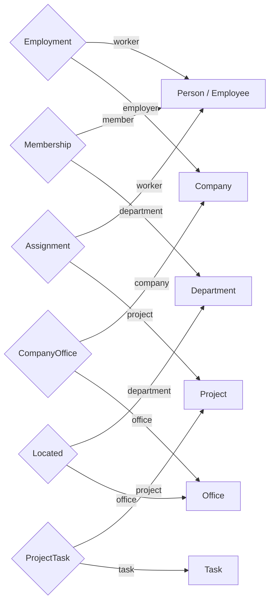

# Complex generated-query fixture

The query joins twelve bindings across a chain and a star: person (including
employee subtypes), company, department, project, task, office, and six keyless
relations. Conditions cover separate witnesses on a multi-valued field,
optional scalar presence, ordering, string matching, disjunction, and negation.
The fixture also checks abstract reads and canonical manager filters. Rust uses
its generated subtype family; Python, Node, and C additionally exercise exact
abstract bindings.



`fixture.py` owns the size-parameterized data generator, independent known
answers, and raw TypeQL oracle. The scaling suite can import `seed_queries(size)`
and `expected_rows(size)`. Every generated SDK runs against the same seeded
database, compares its complete selected values, and checks first/count/exists.
The runner applies the generated migration and deletes both the exact database
and its journal on success or failure. It never starts or reconfigures TypeDB.

Install the repository Python/dev dependencies and Node development dependencies
as described in `DEVELOPMENT.md`. Rebuild the editable Python core after Rust
changes. Use a disk-backed `TMPDIR` and the existing Cargo target directory:

```bash
TMPDIR="$HOME/.cache/type-bridge-complex/tmp" \
CARGO_TARGET_DIR="$PWD/target" \
CARGO_BUILD_JOBS=24 RUSTUP_TOOLCHAIN=1.94.1 \
uv run --no-sync python tests/live/query_complex/run.py \
  --server '3.12.3,127.0.0.1:1729,8000' \
  --server '3.13.6,127.0.0.1:1730,8001' \
  --server '3.14.0,127.0.0.1:1731,8002' \
  --database-prefix type_bridge_complex_ \
  --size 16 --output tmp/complex-query
```

Server arguments are `version,address,http-port`; replace the example endpoints
with the existing servers. The local fixture uses `admin`/`password`. Output must
be a fresh directory. `--sdk python|node|rust|c` can restrict an iteration; omit it
for acceptance. Size 16 returns `P0002/job-0002` and `P0008/job-0008`; size 1
exercises empty matches. List iteration may require the explicit upstream capability skip described below.

Evidence includes native/consumer build logs, emitted packages, raw answers,
and each SDK's observed JSON. A command failure identifies its evidence log.

The runner preserves the original `select; distinct; sort;` raw statement byte for byte, and measures it alongside the current sorted statement and the equivalent fetch-only oracle. Each runs in a separate
process with a 20 second client timeout; `oracles.json` records its outcome and
elapsed time. SDK consumers have a 60 second timeout. Before deleting a database,
the runner waits and opens and closes a fresh read transaction on that database.
A failed probe retains the database and journal and reports their exact names.
Python provider statements are captured in `python-statements.jsonl` for shape
comparison with both raw statements. The fetch-only answer is the comparison
oracle for SDK results; the sorted oracle must agree whenever it completes.

The root Pyright configuration excludes `python.py` because its generated
package exists only in a staged run. The runner checks that consumer with the
staged package on its import path before opening a database.

The generated programs also exercise 2/4/6/8/10 binding prefixes. These restrict
identifiers to `P0002`, `P0004`, or `P0008`, reject the extra employment edge by its note,
and compare score with project priority at ten bindings. Person `P0004` has score 40 and project priority 41: it matches the smaller joins and is excluded by that cross-field comparison. Each prefix checks
sorted rows, offset/limit, first, root-only pagination with total, count, exists,
and identifier-grouped counts against its raw oracle and known answer. Pages
select only the person root; a singular non-root selection is not a valid page
shape. Both present and missing nicknames occur in the seeded answers.

There is a public surface gap: structural optional branches and arbitrary field
list membership have no typed-query or generic-Plan builder. The typed fixture
uses the existing OR-of-equalities form for finite membership and captures the
`try` blocks used for optional attribute hydration. Separate raw programs use
real optional branches and real `let ... in [...]` list iteration through each
SDK's `execute_query`/`executeQuery` entry point. TypeDB versions that reject
lists with `REP254` are recorded explicitly; optional-branch checks still run.
The internal Rust plan fixture proves `QueryPattern::Try` lowering at four and
ten bindings. The current contract IR has no list operand or membership node.

The supported condition shapes are summarized below. “Finite OR” means explicit
OR-of-equalities, not a list operator. “Hydration” means existing optional field
loading, not a user-authored optional structural branch. Manager filters below
refer to the canonical filter unless the compatibility lookup is named.

| SDK and surface | Equality/range | String match | Finite membership | NOT / OR | Optional branch | Cross-field comparison | Order / offset / page / group |
| --- | --- | --- | --- | --- | --- | --- | --- |
| Python typed query | Yes | Yes | Finite OR; IID set | Yes / Yes | Hydration only | Yes | Yes |
| Node typed query | Yes | Yes | Finite OR; IID set | Yes / Yes | Hydration only | Yes | Yes |
| Rust typed query | Yes | Yes | Finite OR; IID set | Yes / Yes | Hydration only | Yes | Yes |
| C typed query | Yes | Yes | Finite OR; IID set | Yes / Yes | Hydration only | Yes | Yes |
| Python manager filter | Yes | No; compatibility string lookups only | Compatibility `__in` lookup | No / No | No | No | No |
| Node manager filter | Yes | No; compatibility string lookups only | Compatibility `__in` lookup | No / No | No | No | No |
| Rust manager filter | Yes | No | No | No / No | No | No | No |
| C manager filter | Yes | No | No | No / No | No | No | No |
| Python generic Plan | Yes | Yes in context DSL | No | No / No | No | Yes | No |
| Node generic Plan | Yes | Yes in context DSL | No | No / No | No | Yes | No |
| Rust generic Plan | Yes | Yes | No | No / No | No | Yes | No |
| C generic Plan | Yes | No | No | No / No | No | Yes | No |
| Python raw TypeQL | Yes | Yes | Server capability | Yes / Yes | Yes | Yes | Yes |
| Node raw TypeQL | Yes | Yes | Server capability | Yes / Yes | Yes | Yes | Yes |
| Rust raw TypeQL | Yes | Yes | Server capability | Yes / Yes | Yes | Yes | Yes |
| C raw TypeQL | Yes | Yes | Server capability | Yes / Yes | Yes | Yes | Yes |

Abstract managers and typed queries read descendants. Generic PlanBuilder reads
require `subtypes` explicitly; `exact` on an abstract type fails at build with
`query_plan_abstract_exact_read`. Rust typed query sessions refuse abstract
`exact` at compile time, and C omits its generated generic exact factory for
abstract models; the public low-level C builder receives the same build error.
The fixture checks generic-plan refusal and subtype-count parity with managers
in every SDK.
